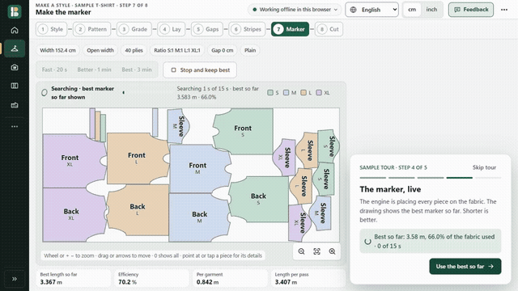
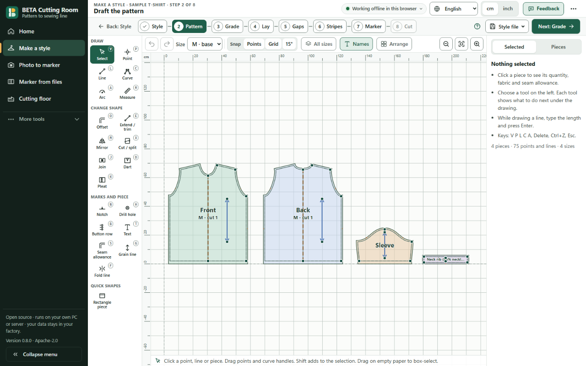

# BETA Cutting Room

**Free, open-source cutting-room software for garment factories.** Patterns, markers and cut plans, in your browser. Nothing to install, no account, and your files stay on your device.

Version 0.8.0 · Apache-2.0 · Browser, Windows, Linux server

[**▶ See it in 60 seconds — no install**](https://sohitqwer-del.github.io/beta-cutting-room/app/#/tour) · [Website](https://sohitqwer-del.github.io/beta-cutting-room/) · [Downloads](https://github.com/sohitqwer-del/beta-cutting-room/releases/latest) · [Features](marker/docs/FEATURES.md) · [FAQ](marker/docs/FAQ.md)

> **A fun project, built with the help of modern AI tools.** It is young and not perfect. **We need your help:** try it on one real style and tell us what is wrong, confusing or missing. Start with the [10-minute guides](marker/docs/GETTING-STARTED.md).

## Who is it for?

- **Small units without CAD:** photograph your paper patterns beside an A4 sheet, check one measurement with a tape, choose the fabric (width, GSM, open / folded / tube) and print or plot the marker.
- **Pattern masters:** start from a T-shirt, shirt, trouser, skirt, kurta, polo or track-pant block, or a blank sheet. Draw, add darts and notches, grade from a size chart, check seams in every size, print a measurement spec sheet.
- **Cutting rooms:** open DXF pieces from your CAD, make the marker, plan the cut for the whole order, inspect rolls, print spreading sheets, make bundles and tickets, and track every lay.

## See the workflow

## What can it do?

### Pattern
- Seven editable blocks driven by a size chart, or a blank sheet; curves, offsets, mirror, split, join, darts, pleats, notches, drill holes, seam allowance, grain and fold lines.
- Grade from a size chart; all sizes stacked; seam checks in every size; 10,806 automatic shape and seam checks on the blocks.
- DXF-AAMA/ASTM (with .rul grade rules) and Seamly2D import; DXF-AAMA, tiled PDF and plotter export; measurement spec sheet (PDF, CSV, Excel).

### Marker
- Nesting in Rust (sparrow + jagua-rs) with garment rules: grain, rotation, mirror pairs, one-way fabric, gaps, fused blocks, defects, shade bands, stripes and checks with match points.
- The marker draws itself live; stop at any time and keep the best. Open, folded and tube lays, with the real fabric yield shown.
- Marker editor: move, rotate, lock, compact. **New in 0.8:** improve one area with preview, Apply and Undo; keep your previous marker if it is still valid and shorter.
- Files: PLT/HPGL, DXF-AAMA, ISO, full-size and tiled PDF, SVG — made in the browser, byte-identical to the desktop app.

### Cutting room
- Cut plan for an order (plies, passes, fabric), rolls and inspection, spreading sheet, bundles and QR tickets, floor tracking, reports.
- **New in 0.8:** compare fabric widths and size ratios by total order cost.

### Small factories (new in 0.8)
- Reusable paper-pattern sets: name parts, sizes, copies and pairs; group by fabric (main, lining, rib, fusing), each with its own width, GSM, lay and gaps.
- Tape check: a marker is blocked until a digital distance matches your tape measurement.

See [every feature and where to find it](marker/docs/FEATURES.md).

## How good is the nesting?

Mixed, and we show it plainly. On 300 real nesting tasks from Lectra's clients (public dataset, CC BY 4.0), 60 seconds per task on a shared machine, 0.8.0 is **1.39 points below Lectra on average** (median −1.57): **77 wins, 12 ties, 211 losses**. Dense markers with 150+ pieces are the weakest. An older run at Lectra's own recorded time (about 5 minutes, 60 tasks) was +0.42 on average with median −0.30.

Compared with 0.7.0 on the same tasks, 0.8.0 is the same on ordinary open fabric. When the roll starts with a flaw, 0.8.0 used **15–25% less fabric** on three test garments. BETA does not claim a general win over commercial CAD. [Method, results and caveats](marker/docs/benchmarks.md).

## Install or build

- **Browser:** use the link above on a PC or phone. After the first visit it works offline. Save a backup file before clearing browser data.
- **Windows:** `BETA-Cutting-Room_0.8.0_x64-setup.exe` or the portable ZIP from [Releases](https://github.com/sohitqwer-del/beta-cutting-room/releases/latest). Check the SHA-256. The installer is not code-signed yet, so SmartScreen may warn you.
- **Linux server:** `BETA-Cutting-Room_0.8.0_linux-x86_64.tar.gz` (glibc 2.31+, e.g. Ubuntu 20.04+). See [self-hosting](marker/docs/SELF-HOSTING.md).
- **Source:** Rust (with the `wasm32-unknown-unknown` target and matching `wasm-bindgen`) and Node.js 22.18+. Then `npm install`, `npm test`, and `cargo test --workspace` in `marker/` and `pattern/`. See [installation and source builds](marker/docs/INSTALL.md).

## Privacy

No account, analytics, automatic upload or licence check. Browser work stays in that browser profile; desktop files stay on the PC; a factory server keeps data on your network. The Feedback button never sends anything by itself. Public issues are public: use synthetic examples, not factory patterns. [Privacy and storage](marker/docs/PRIVACY.md).

## Status and limits

- Folded and tube lays can still use more fabric than open lays, especially for small orders; the app tells you when the fold length limits the marker.
- Blocks pass shape and seam checks but are starting drafts: sew a sample.
- Photo accuracy on real factory photos, real plotters/cutters and clean-PC installs are not yet verified.
- Hindi and Tamil are drafts. The optional nesting strategy comparison is experimental and off by default.

See the [release notes](marker/docs/RELEASE-0.8.0.md), [roadmap](marker/docs/ROADMAP.md) and [FAQ](marker/docs/FAQ.md).

## Help us improve it

- [Report a bug or share feedback](https://github.com/sohitqwer-del/beta-cutting-room/issues/new/choose) · [Discussions](https://github.com/sohitqwer-del/beta-cutting-room/discussions) · [CONTRIBUTING.md](CONTRIBUTING.md) · [Code of conduct](CODE_OF_CONDUCT.md)
- Private security reports: [SECURITY.md](SECURITY.md). Contact: sohitqwer@gmail.com.

## Licence and credits

BETA code is [Apache-2.0](LICENSE), including commercial use. Data and third-party assets keep their own licences: see [NOTICE](NOTICE) and [third-party licences](marker/THIRD-PARTY-LICENSES.md).

Thanks to [sparrow](https://github.com/JeroenGar/sparrow) (MIT) and [jagua-rs](https://github.com/JeroenGar/jagua-rs) (MPL-2.0, used unmodified) for the nesting foundations; FreeSewing (MIT), GarmentCodeData and Open+Pattern (CC BY 4.0) for open test patterns; the Lectra dataset by Lallier and colleagues (Zenodo 7030786, CC BY 4.0), used for benchmarks only and not bundled. Demo narration uses the Kokoro voice model (Apache-2.0); see [audio sources](marker/deploy/video/AUDIO-SOURCES.md). AI tools helped build BETA; people still review its work.
