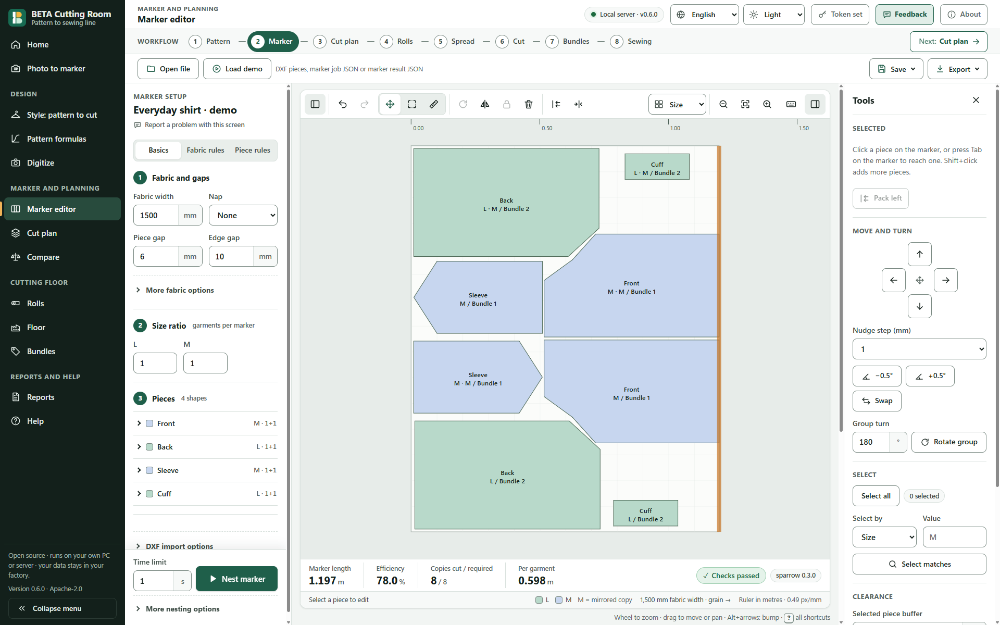

# BETA Cutting Room

**Open-source garment cutting-room software. Self-hosted. Version 0.6.0.**

BETA helps a factory turn patterns into checked markers and cutting-room work.
BETA Pattern covers drafting, grading and photo digitizing. BETA Marker covers
nesting, marker editing, cut planning, rolls, spreading, bundles and floor tracking.
A marker is the arrangement of pattern pieces across a fabric width; shorter
markers use less fabric for the same pieces.

Run the Windows desktop app offline on a factory PC, or host the browser app
and Rust API on your own server. No cloud account is needed. BETA sends no data
to an external service. You control files, access and backups.

## From scratch to cut

The Style workspace joins eight steps: Style, Pattern, Grade, Lay, Gaps,
Stripes, Marker and Cut. Start with a blank sheet or one of seven editable
basic blocks. Review fit with a pattern master before production. Grade from
a size chart, check seams, set fabric and gaps, and inspect the stripe/check
match report before preparing cutting files.

## From pattern to cutting floor

```text
Draft / grade / digitize / import DXF
                  |
                  v
       Set fabric and garment rules
                  |
                  v
        Nest -> edit -> validate -> plot / print / cutter file
                  |
                  v
      Cut plan -> inspected rolls -> spreading -> bundles
                  |
                  v
        Actual use -> re-cuts -> sewing issue ledger
```

All geometry and production calculations run in Rust. The browser uses local
WASM or the factory's Rust server. The desktop uses native Rust through Tauri.
Nesting uses **sparrow 0.3.0** (MIT) on **jagua-rs 1.0.0** (MPL-2.0, unmodified),
with BETA's garment rules and an independent validator.

Features include grain/nap and mirrored-copy rules, folded/tubular fabric,
defects, shrinkage, matching rules, manual marker tools, physical-layer bundles,
QR tickets, reviewed order/roll intake and measured consumption reports.
Some advanced workflows remain CLI-only or need operator verification. This is
not a claim of complete commercial PDS, ERP or machine-controller parity.
Read the [module audit](docs/CUTTING-ROOM-STATUS.md) and
[QA report](docs/QA-2026-10-19.md) before factory acceptance.

## Install

- **Windows desktop:** current-user x64 NSIS installer. WebView2 is a separate
  offline prerequisite. The installer is unsigned; clean-PC and Windows 10
  acceptance remain open.
- **Windows portable:** CLI, browser assets and a local-server launcher in a ZIP.
- **Linux self-hosting:** release CLI plus matching static browser assets;
  systemd user-unit and Caddy/nginx examples are provided.

See the [0.6.0 release record](docs/RELEASE-0.6.0.md) for packages and known limits. See
[installation and source builds](docs/INSTALL.md),
[self-hosting](docs/SELF-HOSTING.md) and the
[public release checklist](docs/RELEASE-CHECKLIST.md).

## Quick start

Desktop: open the app, load an open demo, check units and fabric width, then run
a short nest. Review validation before export and save a project.

Portable: extract the ZIP, run `start-server.cmd`, and open
`http://127.0.0.1:7878`. Stop the console with Ctrl+C.

From a source build, run these commands inside `marker/`. Create `out/` first.
The input is an original public test pattern. These commands assume the CLI is
on PATH; otherwise use its full build path. In a portable Windows PowerShell
session, use `.\beta-marker.exe` from the extracted folder.

```sh
beta-marker import testdata/dxf/shirt-aama-mm.dxf --width 1500 -o out/job.json
beta-marker nest out/job.json --time 5 --workers 2 -o out/result.json
beta-marker validate out/job.json out/result.json
beta-marker export out/job.json out/result.json --format plt -o out/marker.plt
beta-marker serve --web-dir apps/web/dist
```

Use `beta-marker --help` for all commands. Search time excludes setup and
validation. Verify scale and machine profiles on real hardware before cutting
cloth. The server defaults to loopback. Network binding requires a bearer token;
HTTPS needs a reverse proxy.

## Screenshots

These are real 0.4.0 browser-app captures. They use the built-in original shirt
and teaching bodice, plus synthetic roll records. No factory data is shown.



[Pattern](apps/site/public/assets/screens/pattern.png) ?
[Cut plan](apps/site/public/assets/screens/cut-plan.png) ?
[Rolls](apps/site/public/assets/screens/rolls.png) ?
[Spreading](apps/site/public/assets/screens/spreading.png) ?
[Bundles](apps/site/public/assets/screens/bundles.png).

## What the benchmarks show

On the shared Linux server, all 300 sampled Lectra tasks passed independent
validation at a 60-second search budget. BETA's mean efficiency was **0.73
percentage points below** Lectra's recorded result; the median was 1.22 points
below. There were 84 wins, 12 ties and 204 losses.

On the preselected 60-task subset at each task's recorded Lectra time
(244-608 seconds), the mean was **0.42 points above** Lectra, while the median
was **0.30 points below**: 25 wins, 3 ties and 32 losses. A positive mean does
not mean that most tasks improved. The older busy-laptop results were 1.09
points below at matched time and 2.36 below at 60 seconds.

These are unweighted samples, with documented conversion assumptions and
conservative constraint subsets. Lectra's hardware, engine version and worker
count are unknown. Equal time does not mean equal compute, and these results
do not establish commercial parity. See [the full method and results](docs/benchmarks.md).

On **one real knitwear style from an Indian factory, provisional**, BETA made a
marker 4.6-6.7% shorter than the supplied Gemini CAD marker. One style does not
establish a general result. Private source geometry is not published.

BETA does not claim to beat Lectra, Tukatech, Gerber or Optitex. Matched public
comparisons with Tukatech, Gerber and Optitex have not been run.

## Privacy

Patterns and production records stay on the PC or factory server you choose.
BETA adds no analytics or runtime download. Browser drafts belong to the local
browser profile; a server is not a shared document database. Export and back up
work before clearing browser data. See [privacy and storage](docs/PRIVACY.md).

## Contribute

Use public or synthetic inputs. Never commit private factory data, vendor file
specifications or unlicensed samples. Keep computation in Rust, preserve the
independent validator, and use plain English and accessible UI controls.
Follow the [contribution guide](../CONTRIBUTING.md), [specification](SPEC.md)
and ownership rules before changing a shared contract.

Run Rust tests and Clippy in `marker/` and `pattern/`, plus
`npx vitest run marker` at the repository root. Rebuild all three WASM modules
when their Rust source changes. See the [changelog](CHANGELOG.md) and
[release gates](docs/RELEASE-CHECKLIST.md) for current limits.

## Credits and licences

BETA code is **Apache-2.0**. Sparrow is MIT; jagua-rs 1.0.0 is MPL-2.0 and is
used unmodified. The desktop preserves two original Apache-2.0 compatibility
adapters for otherwise MPL-only helper crates. See [NOTICE](NOTICE) and the
[full third-party inventory](THIRD-PARTY-LICENSES.md).

Open fixtures carry their own notices: FreeSewing (MIT), GarmentCodeData and
Open+Pattern (CC BY 4.0). The Lectra dataset by Lallier and colleagues
(Zenodo 7030786, CC BY 4.0) is benchmark-only and is not bundled. Seamly files
and interoperability fixtures have their own source notices; their presence
does not mean BETA incorporates Seamly's application code.
