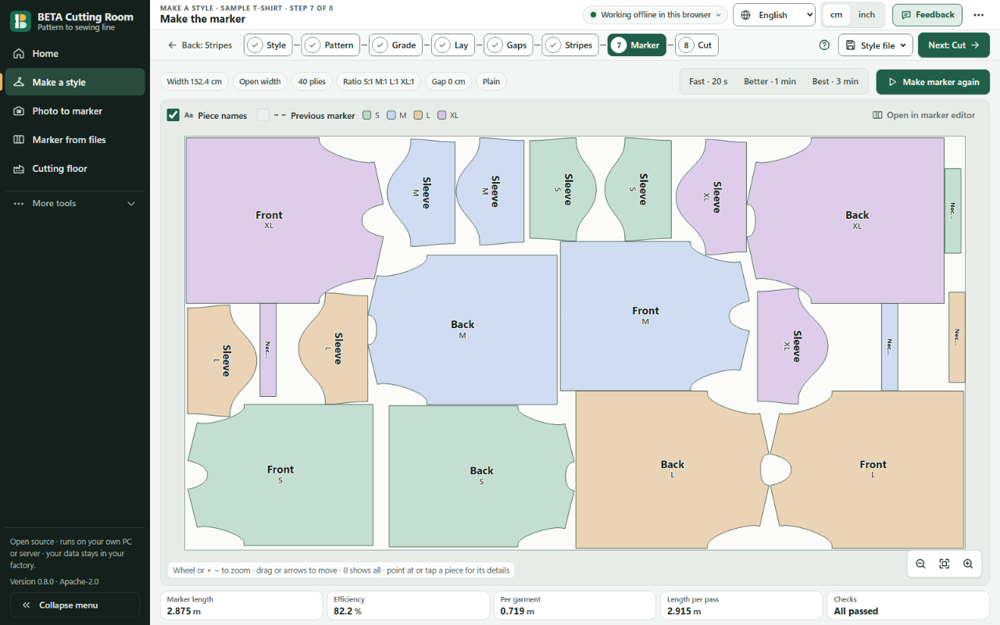
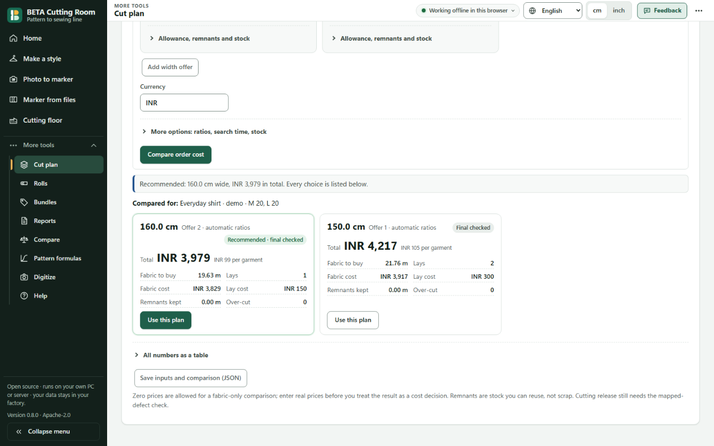

# BETA Cutting Room

**From paper patterns to checked markers and a cut plan. Free, open-source garment tools.**

Licence: Apache-2.0 · Public release: 0.7.0 · 0.8.0: in preparation
Platforms: browser, Windows desktop, Linux server

[**Try it now — no account or install**](https://sohitqwer-del.github.io/beta-cutting-room/app/) · [Website](https://sohitqwer-del.github.io/beta-cutting-room/) · [Downloads](https://github.com/sohitqwer-del/beta-cutting-room/releases)

A marker is a layout of pattern pieces across a fabric width. BETA helps you
make one, check it, print it and plan the cutting work. It runs on your device
or your own factory server.

This is a fun project, built with the help of modern AI tools. It is young and
not perfect. **We need your help.** Try a sample and tell us what failed or felt
confusing. Start with the [10-minute guides](marker/docs/GETTING-STARTED.md).

## See the workflow

<!-- Launch placeholders: add these real captures at public root before publishing. Use public or synthetic inputs only. -->

## Who is it for?

- **Pattern masters:** draft or import pieces, grade sizes and check seams before sewing a sample.
- **Cutting managers:** nest, inspect yield, plan lays and track rolls and bundles.
- **Small factory owners, students and developers:** try local tools without a licence fee, learn how they work and help improve them.

## What can it do?

### Pattern

- Start blank or from seven editable blocks: T-shirt, shirt, trouser, skirt, kurta, polo and track pant.
- Edit curves, allowances, notches and grain; grade from charts or point rules; check graded seams.
- Exchange supported DXF-AAMA/ASTM and Seamly files; export patterns and measurement sheets.

### Marker

- Nest with grain, nap, copy, gap, defect and stripe/check rules; review independent validation.
- Watch the layout improve, then move, lock, compact and compare pieces.
- Export PLT/HPGL, DXF, full-size/tiled PDF, SVG and generic ISO cutter files in the browser.

### Cutting room

- Plan quantities, rolls, spreading, physical layers, bundles and QR tickets.
- Record actual fabric use, damage, re-cuts and bundle issue to sewing.
- Import reviewed order/roll spreadsheets and export reports; no live ERP connection is claimed.

### Small factories

- Photograph paper patterns beside an A4 reference; review scale and outlines locally.
- **Unreleased 0.8, experimental:** reusable paper sets, tape checks and separate fabric groups with GSM.
- **Unreleased 0.8, experimental:** preview/apply/undo area improvement and compare open-fabric width, ratio and order cost.

See [all features and screen locations](marker/docs/FEATURES.md).

## How good is the nesting?

The historical public Lectra comparison is mixed. At 60 seconds on 300 sampled
tasks, mean efficiency was **0.73 percentage points below** Lectra; median was
1.22 below, with 84 wins, 12 ties and 204 losses. At Lectra's recorded duration
on a 60-task subset, mean was 0.42 points above, but median was 0.30 below
(25 wins, 3 ties, 32 losses). These are older native results, not a 0.8 rerun
or phone-speed measurements. Different hardware and unknown vendor settings
limit the comparison. BETA does not claim a general win over commercial CAD.
Read the [method, results and caveats](marker/docs/benchmarks.md).

## Install or build

- **Browser:** use the link above on a PC or phone. After a successful first load and cache, it can work offline. Save a backup file; clearing site data can erase work.
- **Windows:** use the current x64 installer or portable ZIP in Releases. The installer is unsigned and needs WebView2 already installed. Verify the release checksum.
- **Linux server:** use a compatible package or build the CLI. The 0.7 release record says the Linux download still uses 0.6 assets; check the actual release before installing.
- **Source:** Rust 1.90+, Node.js 22+, npm, the WASM target and matching wasm-bindgen. Follow [installation and source builds](marker/docs/INSTALL.md) or [self-hosting](marker/docs/SELF-HOSTING.md).

## Privacy

No account, analytics, automatic upload or runtime licence call. Static browser
work stays in that profile; desktop files stay on the PC. If you choose a
factory server, requests go there. BETA does not encrypt saved files or provide
per-user roles. Back up your work. Read [privacy and storage](marker/docs/PRIVACY.md).
Public issues and feedback attachments are public: use synthetic examples.

## Status and limits

Public 0.7 is available; 0.8 features are implemented in development and still
need launch acceptance. Real-photo accuracy is not established. Blocks need
sewn samples. Folded/tube layouts can waste more fabric than open layouts,
especially on small odd orders: compare useful yield and metres per garment.
Hindi/Tamil text is draft. Real plotter/cutter calibration, clean-PC installer
checks and independent security review remain open. There is no 3D fit,
shared approval database or full commercial CAD parity.
See the [FAQ](marker/docs/FAQ.md), [roadmap](marker/docs/ROADMAP.md) and
[0.7 limits](marker/docs/RELEASE-0.7.0.md).

## Help us improve it

[Report a bug or share feedback](https://github.com/sohitqwer-del/beta-cutting-room/issues/new/choose),
[join Discussions](https://github.com/sohitqwer-del/beta-cutting-room/discussions),
or read [CONTRIBUTING.md](CONTRIBUTING.md). Discussions must be enabled by the
maintainer. A small reproducible example helps us improve.
For private security reports use [SECURITY.md](SECURITY.md).
Contact: sohitqwer@gmail.com.

## Licence and credits

BETA code is [Apache-2.0](LICENSE), including commercial use under its terms.
Data and third-party assets have separate licences; preserve their notices.
See [NOTICE](NOTICE) and [third-party licences](marker/THIRD-PARTY-LICENSES.md).

Thanks to [sparrow](https://github.com/JeroenGar/sparrow) (MIT) and
[jagua-rs](https://github.com/JeroenGar/jagua-rs) (MPL-2.0, used unmodified)
for nesting foundations; FreeSewing (MIT), GarmentCodeData and Open+Pattern
(CC BY 4.0) for open fixtures. The Lectra dataset by Lallier and colleagues
(Zenodo 7030786, CC BY 4.0) is benchmark-only and is not bundled.
Seamly fixtures keep their own notices; BETA does not include its GPL app code.
Demo audio tooling uses Kokoro voice/model assets (Apache-2.0); see
[audio sources](marker/deploy/video/AUDIO-SOURCES.md) for exact asset notices.
AI tools helped build BETA; people must still review its work.
